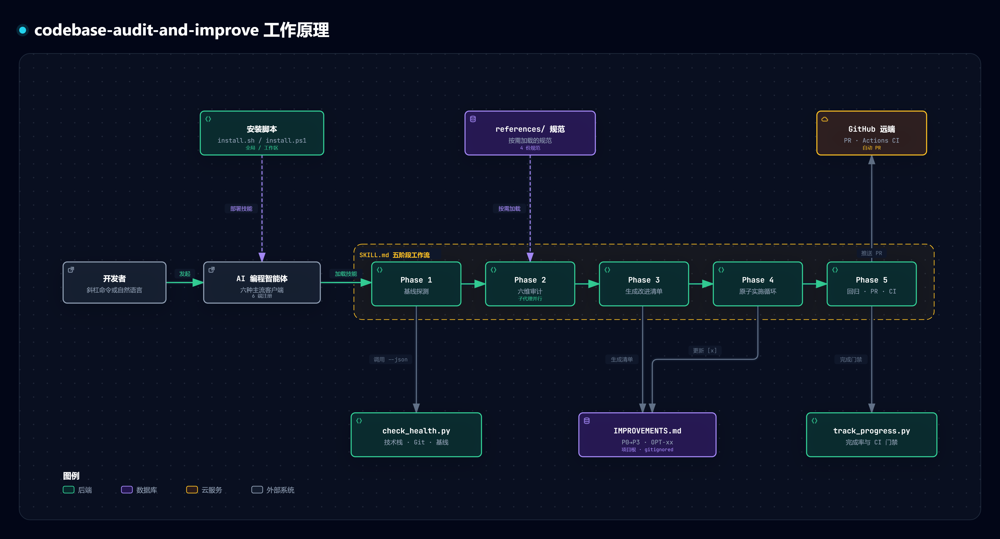

# 通用代码库全方位审计与改进工作流 (`codebase-audit-and-improve`)

[](https://github.com/Aclguh/codebase-audit-and-improve)
[](https://github.com/Aclguh/codebase-audit-and-improve)
[](https://github.com/Aclguh/codebase-audit-and-improve/actions)
[](https://opensource.org/licenses/MIT)
[](https://conventionalcommits.org)
[](https://github.com/Aclguh/codebase-audit-and-improve/pulls)

[English](README.md) | [简体中文](README_zh.md)

---

**`codebase-audit-and-improve`** 是一套通用的生产级 **AI 编程智能体审计与改进工作流 Skill**（注册命令为 `/improve` 与 `/improve-all`）。原生遵循开放的 **Agent Skills Specification** 规范，跨平台兼容 Claude Code、OpenAI Codex、Cursor、Google Antigravity、DeepSeek Harness、Continue.dev 等主流 AI 编程助手，将高层级架构审计与原子化工程落地紧密结合，通过结构化的 `IMPROVEMENTS.md` 实现端到端可追溯的代码治理与自主重构。

## 工作原理图



从多 Agent 安装分发、`SKILL.md` 五阶段工作流，到 `IMPROVEMENTS.md` 路线图与 PR / CI 交付闭环的端到端流程。

## 多智能体兼容性矩阵 (Multi-Agent Matrix)

本项目遵循开放技能标准，为各大主流 AI 编程助手提供原生输入框 `/` 补全预览与技能调度支持：

| AI 智能体 / 工具 | 触发语法 | 输入框补全预览 (`/` 提示) | 配置文件作用域 |
| :--- | :--- | :--- | :--- |
| **Anthropic Claude Code** | `/improve`, `/improve-all` | 终端命令行原生下拉卡片 | `~/.claude/skills/` |
| **Cursor IDE** | `/improve`, `/improve-all` | Composer / 聊天窗下拉卡片 | `~/.cursor/rules/` 或 `.cursor/commands/` |
| **OpenAI Codex (桌面端)** | `/imp` -> `Improve`, `Improve All` | 桌面端 Composer 原生下拉 | `~/.agents/skills/` |
| **OpenAI Codex (CLI 终端)** | `$improve`, `$improve-all` 或 `/skills` | `$` 符号引用与 `/skills` 交互面板 | `~/.agents/skills/` |
| **DeepSeek Harness (dsh)** | `/improve`, `/improve-all` | Web UI / TUI / 桌面端提示卡片 | `~/.agents/skills/` |
| **Google Antigravity** | `/improve`, `/improve-all` | 原生 Skill 调色板与斜杠补全 | `~/.gemini/config/skills/` |
| **Continue.dev** | `/improve`, `/improve-all` | VS Code / JetBrains 下拉菜单 | `~/.continue/config.json` |

## 核心特性

- **六大维度深度体检与并发子代理支持**：
  1. **架构设计**：检测上帝类/上帝组件、模块分层跨越、Monorepo 包隔离。
  2. **代码质量**：增量零容忍门禁（0 错误、0 新增告警）、类型严格性、异常吞没防护。
  3. **性能与响应度**：主线程同步 I/O 阻塞、单点打字全量重绘、流式与内存占用。
  4. **可维护性**：国际化覆盖、依赖过时、分级日志规范。
  5. **安全性与沙箱**：目录穿越漏洞防御、命令注入防御、解压防 Zip Slip。
  6. **测试与质量**：关键逻辑单测盲区、回归断言、CI 友好度。
  *(针对大型项目，支持调用只读子代理或后台并发线程并行扫描，保护主会话上下文)*
- **全生态与 Monorepo 适配**：开箱即用支持 Flutter/Dart, Node.js (npm/pnpm/yarn/bun), Python (uv/poetry/pdm), Rust, Go, Java/Kotlin (Maven/Gradle), .NET/C#, C/C++ (CMake), PHP, Ruby 等。
- **结构化进度追踪 (`IMPROVEMENTS.md`)**：
  - 自动保障已在 `.gitignore` 中忽略，不污染远程代码仓库。
  - 标准化任务排期表（P0 紧急阻塞 -> P3 规范打磨），分配独立编号（`OPT-01`、`OPT-02` 等）。
  - 支持“归档模式”：全部落地后自动归档至 `docs/audits/`，沉淀为团队架构资产。
- **增量零容忍质量门禁 (Incremental Zero-Tolerance)**：
  - 一项改进对应一次独立 Git Commit（Conventional Commits 规范）。
  - 区分存量债务与增量告警：**0 错误、0 新增告警，全仓告警总数 <= 基线告警数**，避免老项目历史 warning 阻断紧急修复。
  - **分级测试**：原子循环期间执行受影响模块的轻量单测，全量回归放到 Phase 5 最终收敛阶段。
- **保护分支防御与自动化 PR 流**：
  - 自动识别当前是否为保护分支（`main`, `master`, `release`）。
  - 在保护分支上自动拉取特性分支并通过 GitHub CLI (`gh pr create`) 提 PR，防止直接向主干强推。
- **目标驱动与自主推进**：
  - 与自主执行模式（如 `/improve-all`、`/goal 全部实现` 或后台任务循环）深度集成，全量通过测试与验证方可终止退出。

## 快速上手与多 Agent 安装

### 1. 全局一键安装（全生态支持）

一键安装到本地所有已检测到的 Agent 工具目录中：

**PowerShell (Windows):**
```powershell
git clone https://github.com/Aclguh/codebase-audit-and-improve.git
cd codebase-audit-and-improve
.\install.ps1 -Target All
```

**Bash (Linux / macOS):**
```bash
git clone https://github.com/Aclguh/codebase-audit-and-improve.git
cd codebase-audit-and-improve
chmod +x install.sh && ./install.sh all
```

*提示：也可以指定单一工具安装：`-Target Claude`、`-Target Codex`、`-Target Cursor`、`-Target DeepSeek`、`-Target Antigravity` 或 `-Target Continue`。*

### 2. 工作区专属安装（随项目提交团队共享）

直接在当前代码仓库工作区生成配置，团队内任何使用 Claude Code、Codex、Cursor、DeepSeek Harness、Antigravity 或 Continue 的成员打开项目输入 `/` 即可联想补全：

```powershell
# Windows
.\install.ps1 -Target All -Workspace

# Linux / macOS
./install.sh all --workspace
```

## 使用指南

### 方式 1：全自主端到端执行 (`/improve-all`)

一键串联基线检测、六维审计、路线图生成、原子提交循环、文档归档、提 PR 与 CI 监控：

```text
/improve-all
```
*(在不支持斜杠命令的环境中，可直接输入：`执行 improve-all 对当前代码库进行全方位体检与重构`)*

执行流程：
1. 前置工作区干净度与基线检测 (`check_health.py --json`)。
2. 六维度深度体检（支持子代理/后台并发线程分治）。
3. 生成结构化 `IMPROVEMENTS.md`。
4. 自动按 P0 -> P3 顺序逐项原子实现（增量零容忍、分级单测、Conventional Commits）。
5. 全仓回归测试、归档/清理路线图、保护分支创建 PR、推送远程并监控 GitHub Actions CI 绿灯。

---

### 方式 2：分步交互式工作流 (`/improve`)

若希望在落地前先审阅审计发现与重构方案：

#### 1. 生成改进路线图
```text
/improve
```
*(在 Codex CLI 中输入 `$improve`；或在对话中输入：`使用 improve 技能进行代码库体检`)*

智能体将审计代码库并生成包含定量评分与优先级清单的 `IMPROVEMENTS.md`。

#### 2. 触发自主落地
针对方案确认无误后，指示 Agent 开始落地：
```text
原子化实现 IMPROVEMENTS.md 中的所有改进项
```
*(在支持 `/goal` 的工具中亦可直接使用 `/goal 全部实现` 或 `/goal implement all`)*

#### 3. 验收与远程提交
当清单项全部勾选完毕后：
```text
运行全量测试套件，push 并监控 GitHub CI 状态
```

## 仓库结构

```
codebase-audit-and-improve/
├── SKILL.md                     # 通用 Agent Skill 入口主定义 (/improve, /improve-all)
├── README.md                    # 英文文档
├── README_zh.md                 # 中文文档
├── LICENSE                      # MIT 开源协议
├── install.ps1                  # Windows 多 Agent 安装脚本
├── install.sh                   # Linux/macOS 多 Agent 安装脚本
├── references/                  # 参考规范与指导手册（按需加载）
│   ├── audit-dimensions.md      # 六大维度深度审计清单与子代理指导
│   ├── improvements-template.md # 通用 IMPROVEMENTS.md 标准模板
│   ├── execution-loop.md        # 原子循环规范、增量门禁与分级测试
│   └── ci-monitoring.md         # 分支保护、自动化 PR 与 CI 排查
├── scripts/                     # 辅助工具脚本
│   ├── check_health.py          # 技术栈识别、Monorepo 诊断与基线检测
│   └── track_progress.py        # 进度解析、动态列匹配与 CI 门禁检查
├── skills/                      # 预置单技能定义
│   ├── improve/                 # /improve Skill
│   └── improve-all/             # /improve-all Skill
├── templates/                   # 非标 Agent 的集成模板
│   ├── continue/                # Continue.dev 自定义命令配置
│   └── cursor/                  # Cursor IDE 命令模板
├── tests/                       # 自动化单元测试套件
│   ├── test_check_health.py     # 探针工具测试
│   └── test_track_progress.py   # 进度解析工具测试
└── examples/
    └── sample-improvements.md   # 生产级样本 IMPROVEMENTS.md
```

## 辅助脚本速查

```bash
# 检测当前项目技术栈、Monorepo 及 Git 工作区保护状态
python scripts/check_health.py

# 输出供 Agent 消费的结构化 JSON
python scripts/check_health.py --json

# 自动将 IMPROVEMENTS.md 追加至 .gitignore
python scripts/check_health.py --fix-gitignore

# 解析 IMPROVEMENTS.md 中的实施进度与完成率
python scripts/track_progress.py IMPROVEMENTS.md

# CI 门禁模式（100% 完成返回 0，存在未完成项返回 1）
python scripts/track_progress.py --check

# 执行自动化测试套件
python -m unittest discover tests
```

## 开源协议

本项目采用 [MIT 许可证](./LICENSE) 开源。
